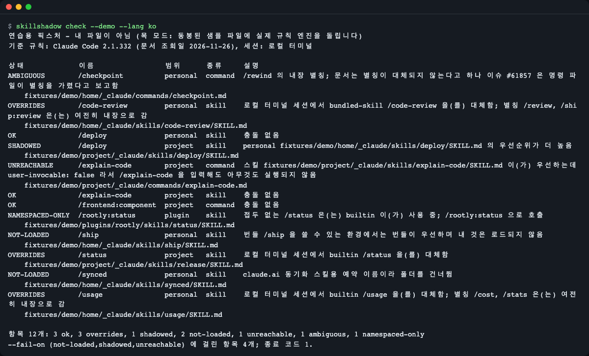
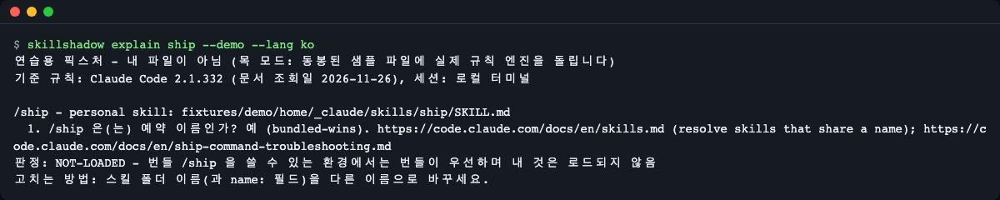
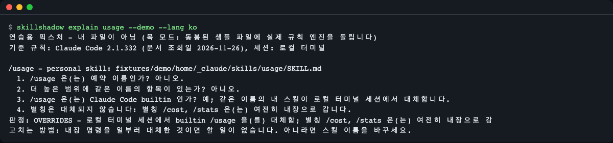
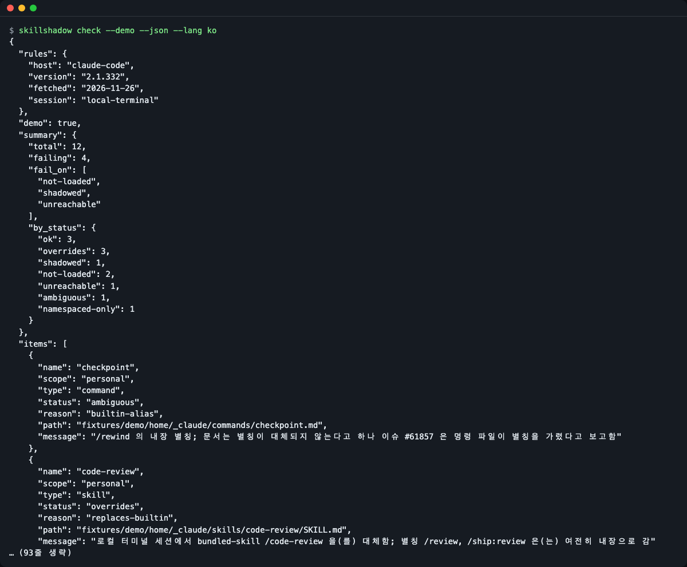
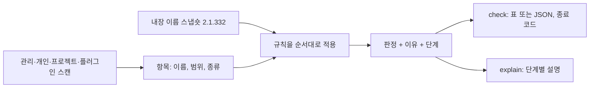

# skillshadow

[English](README.md) | **한국어**

skillshadow 는 내 Claude Code 스킬·슬래시 명령 중 실제로 동작하지 않는 것과 그것을 가린 대상을 알려 주는 작은 CLI 입니다. 문서에 적힌 이름 해석 규칙(범위 우선순위, 내장 명령, 별칭, 예약 이름)을 내가 가진 파일에 그대로 적용해 봅니다. Claude Code 업데이트 직후, 스킬을 새로 추가할 때, CI 에서 쓰세요.


*`skillshadow check --demo`: 스킬·명령 파일마다 한 줄, 상태와 이유가 나옵니다.*

## 이런 분께

- `~/.claude/skills`·`~/.claude/commands` 에 스킬을 많이 두었는데, 어느 날 `/ship` 이나 `/usage` 가 예전처럼 동작하지 않는 분.
- 저장소에 `.claude/skills` 를 커밋하는 팀에서, 개인 스킬에 밀려 프로젝트 스킬이 가려지면 CI 를 실패시키고 싶은 분.
- 플러그인을 만들면서 접두 없는 `/이름` 이 이미 내장 명령에 쓰이는지 알고 싶은 분.

## 설치

Node.js 22 이상이 필요합니다(`brew install node` 또는 https://nodejs.org/). 최소 리눅스 환경에서는 `git`, `npm` 도 필요합니다(예: `apt-get install -y git nodejs npm` 후 `node --version` 이 22 이상인지 확인).

```bash
git clone https://github.com/LeeGyeongPil/skillshadow.git
cd skillshadow
npm ci
npm run build
node dist/cli.js --version
```

```text
skillshadow 0.1.0
```

패키지가 npm 레지스트리에 올라가면 클론 없이 `npx skillshadow check` 로도 실행할 수 있습니다. 아래 명령은 `node dist/cli.js` 를 쓰며, 클론 폴더 안에서 그대로 입력하면 됩니다.

## 빠르게 시작하기

먼저 동봉된 연습용 픽스처로 체험해 보세요. 연습용 목(mock) 모드입니다: 실제 규칙 엔진이 돌지만 내 파일이 아니라 도구에 동봉된 샘플 파일을 대상으로 합니다.

```bash
node dist/cli.js check --demo --lang ko
```

```text
연습용 픽스처 - 내 파일이 아님 (목 모드: 동봉된 샘플 파일에 실제 규칙 엔진을 돌립니다)
기준 규칙: Claude Code 2.1.332 (문서 조회일 2026-11-26), 세션: 로컬 터미널

상태             이름                 범위      종류     설명
AMBIGUOUS        /checkpoint          personal  command  /rewind 의 내장 별칭; 문서는 별칭이 대체되지 않는다고 하나 이슈 #61857 은 명령 파일이 별칭을 가렸다고 보고함
OVERRIDES        /code-review         personal  skill    로컬 터미널 세션에서 bundled-skill /code-review 을(를) 대체함; 별칭 /review, /ship:review 은(는) 여전히 내장으로 감
OK               /deploy              personal  skill    충돌 없음
SHADOWED         /deploy              project   skill    personal fixtures/demo/home/_claude/skills/deploy/SKILL.md 의 우선순위가 더 높음
UNREACHABLE      /explain-code        project   command  스킬 fixtures/demo/project/_claude/skills/explain-code/SKILL.md 이(가) 우선하는데 user-invocable: false 라서 /explain-code 을 입력해도 아무것도 실행되지 않음
OK               /explain-code        project   skill    충돌 없음
OK               /frontend:component  project   command  충돌 없음
NAMESPACED-ONLY  /rootly:status       plugin    skill    접두 없는 /status 은(는) builtin 이(가) 사용 중; /rootly:status 으로 호출
NOT-LOADED       /ship                personal  skill    번들 /ship 을 쓸 수 있는 환경에서는 번들이 우선하며 내 것은 로드되지 않음
OVERRIDES        /status              project   skill    로컬 터미널 세션에서 builtin /status 을(를) 대체함
NOT-LOADED       /synced              personal  skill    claude.ai 동기화 스킬용 예약 이름이라 폴더를 건너뜀
OVERRIDES        /usage               personal  skill    로컬 터미널 세션에서 builtin /usage 을(를) 대체함; 별칭 /cost, /stats 은(는) 여전히 내장으로 감

항목 12개: 3 ok, 3 overrides, 1 shadowed, 2 not-loaded, 1 unreachable, 1 ambiguous, 1 namespaced-only
--fail-on (not-loaded,shadowed,unreachable) 에 걸린 항목 4개; 종료 코드 1.
```

실제 실행에서는 각 줄 아래에 파일 경로가 한 줄씩 더 붙습니다(여기서는 줄였습니다). 기본 `--fail-on` 목록에 걸린 항목이 4개라 종료 코드가 1 입니다. 다음은 내가 일하는 프로젝트 폴더에서 내 파일로 실행합니다.

```bash
node dist/cli.js check
```

### 상태의 뜻

| 상태 | 뜻 |
|---|---|
| `ok` | 충돌 없음. |
| `overrides` | 내 항목이 내장 명령·번들 스킬과 같은 이름이라 로컬 터미널 세션에서 그것을 대체합니다. 별칭은 여전히 내장으로 갑니다. |
| `shadowed` | 같은 이름의 다른 항목이 이깁니다(더 높은 범위, 또는 명령 파일보다 스킬). |
| `not-loaded` | 예약 이름(예: 번들 `/ship`)이라 내 항목은 아예 로드되지 않습니다. |
| `unreachable` | 이기는 항목이 `user-invocable: false` 라서 이름을 입력해도 아무것도 실행되지 않습니다. |
| `ambiguous` | 문서와 사용자 보고가 어긋나거나 문서가 말이 없습니다. 추측하지 않습니다. |
| `namespaced-only` | 접두 없는 이름을 다른 것이 쓰는 플러그인 항목. `/플러그인:이름` 으로만 호출됩니다. |

## 사용법

| 명령·옵션 | 하는 일 | 예 |
|---|---|---|
| `check` | 가진 스킬·명령 파일을 모두 판정 | `skillshadow check` |
| `explain <이름>` | 한 이름의 해석 과정을 단계별로 표시 | `skillshadow explain ship` |
| `--project <dir>` | 프로젝트 시작 폴더 (기본: 현재 폴더) | `--project ../my-repo` |
| `--home <dir>` | 개인 설정 폴더의 부모 (기본: 홈 폴더) | `--home /tmp/h` |
| `--user-dir <dir>` | 개인 설정 폴더 자체 (기본: `$CLAUDE_CONFIG_DIR` 또는 `~/.claude`) | `--user-dir ~/.claude` |
| `--managed-dir <dir>` | `skills/`·`commands/` 를 담은 관리(엔터프라이즈) 폴더 | `--managed-dir /etc/claude-code` |
| `--plugin-dir <dir>` | 포함할 플러그인 폴더 (여러 번 지정 가능) | `--plugin-dir ./my-plugin` |
| `--config-dir-name <n>` | 홈·프로젝트 안의 설정 폴더 이름 (기본 `.claude`) | `--config-dir-name _claude` |
| `--builtins <file>` | 동봉 스냅숏 대신 쓸 내장 이름 스냅숏 | `--builtins mine.json` |
| `--json` | 표 대신 JSON 출력 (`check` 만) | `check --json` |
| `--fail-on <목록\|none>` | `check` 가 종료 코드 1 을 내는 상태 (기본 `not-loaded,shadowed,unreachable`) | `--fail-on none` |
| `--demo` | 동봉된 연습용 픽스처 사용 | `check --demo` |
| `--lang <en\|ko>` | 출력 언어 | `--lang ko` |
| `-h`, `--help` / `-v`, `--version` | 도움말 / 버전 | |

종료 코드: `0` 고칠 것 없음, `1` `--fail-on` 에 걸린 항목 있음, `2` 사용 오류(예: 없는 `--project` 폴더).

### 시나리오 1: 내 `/ship` 스킬이 왜 조용할까?

```bash
node dist/cli.js explain ship --demo --lang ko
```

```text
연습용 픽스처 - 내 파일이 아님 (목 모드: 동봉된 샘플 파일에 실제 규칙 엔진을 돌립니다)
기준 규칙: Claude Code 2.1.332 (문서 조회일 2026-11-26), 세션: 로컬 터미널

/ship - personal skill: fixtures/demo/home/_claude/skills/ship/SKILL.md
  1. /ship 은(는) 예약 이름인가? 예 (bundled-wins). https://code.claude.com/docs/en/skills.md (resolve skills that share a name); https://code.claude.com/docs/en/ship-command-troubleshooting.md
판정: NOT-LOADED - 번들 /ship 을 쓸 수 있는 환경에서는 번들이 우선하며 내 것은 로드되지 않음
고치는 방법: 스킬 폴더 이름(과 name: 필드)을 다른 이름으로 바꾸세요.
```


*`explain` 은 판정을 정하는 첫 규칙에서 멈추고 고치는 방법을 알려 줍니다.*

### 시나리오 2: `/usage` 를 대체했는데 `/cost` 는?

```bash
node dist/cli.js explain usage --demo --lang ko
```

```text
/usage - personal skill: fixtures/demo/home/_claude/skills/usage/SKILL.md
  1. /usage 은(는) 예약 이름인가? 아니오.
  2. 더 높은 범위에 같은 이름의 항목이 있는가? 아니오.
  3. /usage 은(는) Claude Code builtin 인가? 예; 같은 이름의 내 스킬이 로컬 터미널 세션에서 대체합니다.
  4. 별칭은 대체되지 않습니다: 별칭 /cost, /stats 은(는) 여전히 내장으로 갑니다.
판정: OVERRIDES - 로컬 터미널 세션에서 builtin /usage 을(를) 대체함; 별칭 /cost, /stats 은(는) 여전히 내장으로 감
고치는 방법: 내장 명령을 일부러 대체한 것이면 할 일이 없습니다. 아니라면 스킬 이름을 바꾸세요.
```

(위 두 줄 머리말은 생략했습니다.) 스킬은 `/usage` 를 대체하지만 `/cost`·`/stats` 는 여전히 내장 명령을 엽니다.


*번호 붙은 네 단계 뒤에 판정이 나옵니다.*

### 시나리오 3: CI 에서 막기

```bash
node dist/cli.js check --demo --json > shadow-report.json
echo "exit: $?"
```

`--fail-on` 에 걸린 항목이 있으면 종료 코드가 1 이라 CI 작업이 스스로 실패합니다(내 파일을 보려면 `--demo` 를 빼세요). 실패 없이 보고서만 보려면 `--fail-on none`, 더 엄격하게 하려면 `ambiguous,overrides` 를 더하세요. JSON 에는 `rules`, `summary`(`total`, `failing`, `fail_on`, `by_status`), `items` 가 있고(`--demo` 일 때만 `demo: true` 도 있음) 항목마다 `name`, `scope`, `type`, `status`, `reason`, `path`, `message` 가 있습니다. `status`·`reason` 은 번역되지 않고 `message` 만 번역됩니다.


*`check --demo --json` 출력의 첫 부분.*

## 설정

- 언어: `--lang en|ko` 가 `SKILLSHADOW_LANG` 보다, 그다음 `LC_ALL`, `LC_MESSAGES`, `LANG` 순으로 우선합니다(`ko` 로 시작하면 한국어, 아니면 영어). 예: `SKILLSHADOW_LANG=ko node dist/cli.js check --demo`.
- 색: 대화형 터미널에서만 켜지고, `NO_COLOR=1` 로 끌 수 있습니다. `--json` 에는 색이 없습니다.
- 스캔 범위: 관리(`--managed-dir`), 개인(`--user-dir` 또는 `~/.claude`), 프로젝트 폴더와 git 루트까지의 상위 폴더. `.git` 이 없으면 시작 폴더만 읽습니다. `--plugin-dir` 로 플러그인 스킬을 더합니다.
- 규칙 스냅숏: Claude Code 2.1.332 의 내장 이름(147개)이 `builtins/claude-code-2.1.332.json` 에 들어 있습니다. `npm run build && node scripts/build-snapshot.mjs <commands.md> <version> <날짜> > out.json` 으로 다시 만들거나 `--builtins` 로 직접 지정하세요.
- 목 vs 실제: `--demo` 는 동봉된 픽스처만 읽고 `CLAUDE_CONFIG_DIR`·관리 폴더를 무시합니다. `--demo` 없이는 내 실제 파일을 읽기만 하며 아무것도 바꾸지 않습니다.

행마다 근거가 된 공식 문서 페이지를 단 전체 규칙표는 [docs/rules.md](docs/rules.md) 에 있습니다(영어).

## 동작 원리



1. 스캐너가 스킬 폴더(`SKILL.md`, 이름은 front matter 또는 폴더명)와 명령 파일(`commands/a/b.md` 는 `/a:b`)을 읽습니다.
2. 동봉된 스냅숏에 내장 명령·번들 스킬·별칭·예약 이름이 들어 있습니다.
3. `src/resolve.ts` 의 판정기가 예약 이름, 명령 파일보다 스킬, 범위 우선순위(관리, 개인, 프로젝트), 내장·별칭, 플러그인 접두 없는 이름 순으로 확인합니다.
4. 모든 판정이 `steps` 를 갖고 있어 `explain` 이 출력하고 `check` 가 요약합니다.
5. 문서와 버그 보고가 어긋나는 곳은 추측 대신 `ambiguous` 로 둡니다.

## 언제 쓰나

- 이럴 때: 로컬 터미널 세션의 이름 해석에 대해 빠르고 오프라인으로, 읽기만 하는 답이 필요하고 CI 용 종료 코드가 필요할 때.
- 다루지 않는 것: 비대화형(`-p`)·IDE 세션, 중첩 스킬 폴더, `--add-dir` 폴더, MCP 서버 스킬, claude.ai 동기화 스킬은 스캔하지 않습니다. 관리 폴더 구조는 가정입니다.
- 규칙은 Claude Code 버전마다 바뀝니다. 스냅숏은 2.1.332 이므로 버전이 다르면 결과를 힌트로 보고 [공식 문서](https://code.claude.com/docs/en/skills.md)와 비교하세요.

## 자주 겪는 문제

| 증상 | 원인 | 해결 |
|---|---|---|
| `오류: --project 폴더를 찾을 수 없습니다: ...` (종료 코드 2) | `--project` 로 준 폴더가 없음 | 존재하는 폴더를 지정 |
| `스킬·명령을 찾지 못했습니다.` | 도구가 현재 폴더에서 시작해 그곳의 `.claude` 를 읽음 | 프로젝트 폴더에서 실행하거나 `--project` 지정 |
| 출력이 뜻밖에 한국어·영어로 나옴 | `LANG` 또는 `SKILLSHADOW_LANG` 이 설정됨 | `--lang en` 또는 `--lang ko` 지정 |
| 보고서만 보고 싶은데 CI 가 실패함 | 기본 `--fail-on` 에 `not-loaded,shadowed,unreachable` 포함 | `--fail-on none` |
| `explain foo` 가 "not found" 를 출력 | 그 이름의 파일·내장 명령이 없음(종료 코드는 0) | 철자 확인; 이름은 소문자로 비교 |
| `node: not found` 또는 문법 오류 | Node.js 22 미만 | Node.js 22 이상 설치 |

## 개발·기여

```bash
npm ci
npm test
```

`npm test` 는 빌드 후 `node:test` 로 테스트 66개를 실행합니다(런타임 의존성 없음). 버그·제안은 이슈로 남겨 주세요. 변경 기록은 [CHANGELOG.md](CHANGELOG.md).

## 라이선스

MIT. 내장 이름 스냅숏은 Claude Code 공식 문서(https://code.claude.com/docs/en/commands.md, 2026-11-26 확인)에서 가져왔습니다.
