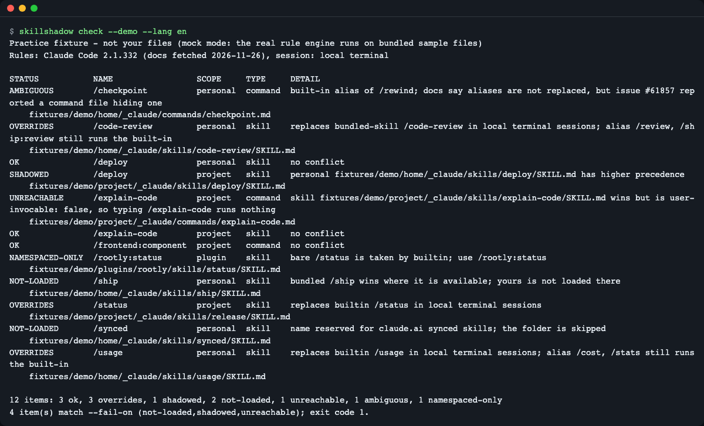
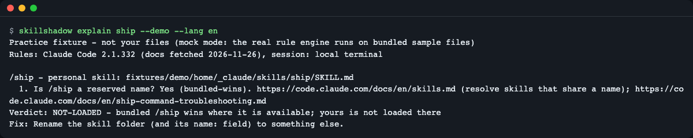
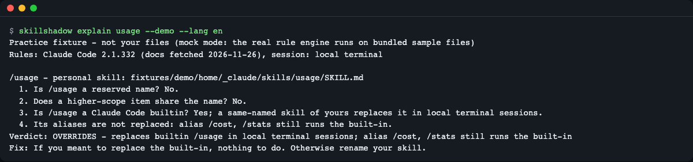
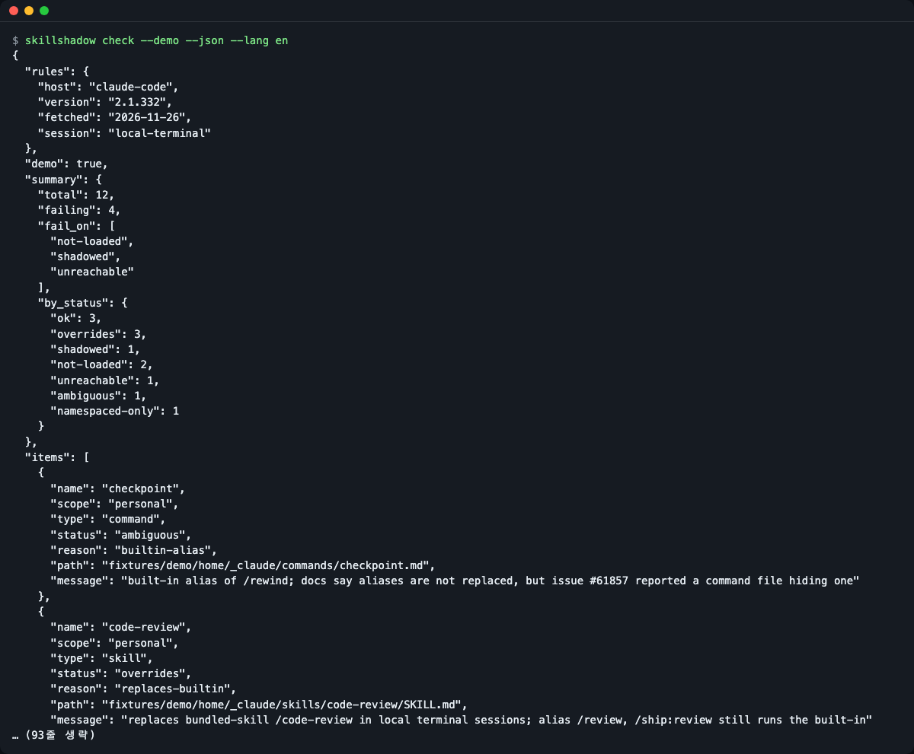
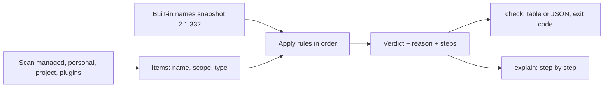

# skillshadow

**English** | [한국어](README.ko.md)

skillshadow is a small CLI that tells you which of your Claude Code skills and slash commands do not actually run, and who shadowed them. It replays the documented name-resolution rules (scope precedence, built-in commands, aliases, reserved names) on the files you really have. Run it after a Claude Code update, when you add a skill, or in CI.


*`skillshadow check --demo`: one row per skill or command file, with a status and the reason.*

## Who is this for

- You keep many skills in `~/.claude/skills` or `~/.claude/commands`, and one day `/ship` or `/usage` stopped doing what it used to.
- Your team commits `.claude/skills` to a repository and wants CI to fail when a project skill is hidden by a personal one.
- You write a plugin and want to know whether its bare `/name` is already taken by a built-in.

## Install

Requires Node.js 22 or newer (`brew install node`, or see https://nodejs.org/). On a minimal Linux image you also need `git` and `npm` (for example `apt-get install -y git nodejs npm`, then check `node --version` is 22+).

```bash
git clone https://github.com/LeeGyeongPil/skillshadow.git
cd skillshadow
npm ci
npm run build
node dist/cli.js --version
```

```text
skillshadow 0.1.1
```

Once the package is on the npm registry you can also run it without cloning: `npx skillshadow check`. The commands below use `skillshadow` for `node dist/cli.js`; inside the clone, type the longer form.

## Quick start

Try it on the bundled practice fixture first. This is a mock mode: the real rule engine runs, but on sample files shipped with the tool, not on your files.

```bash
node dist/cli.js check --demo --lang en
```

```text
Practice fixture - not your files (mock mode: the real rule engine runs on bundled sample files)
Rules: Claude Code 2.1.332 (docs fetched 2026-11-26), session: local terminal

STATUS           NAME                 SCOPE     TYPE     DETAIL
AMBIGUOUS        /checkpoint          personal  command  built-in alias of /rewind; docs say aliases are not replaced, but issue #61857 reported a command file hiding one
OVERRIDES        /code-review         personal  skill    replaces bundled-skill /code-review in local terminal sessions; alias /review, /ship:review still runs the built-in
OK               /deploy              personal  skill    no conflict
SHADOWED         /deploy              project   skill    personal fixtures/demo/home/_claude/skills/deploy/SKILL.md has higher precedence
UNREACHABLE      /explain-code        project   command  skill fixtures/demo/project/_claude/skills/explain-code/SKILL.md wins but is user-invocable: false, so typing /explain-code runs nothing
OK               /explain-code        project   skill    no conflict
OK               /frontend:component  project   command  no conflict
NAMESPACED-ONLY  /rootly:status       plugin    skill    bare /status is taken by builtin; use /rootly:status
NOT-LOADED       /ship                personal  skill    bundled /ship wins where it is available; yours is not loaded there
OVERRIDES        /status              project   skill    replaces builtin /status in local terminal sessions
NOT-LOADED       /synced              personal  skill    name reserved for claude.ai synced skills; the folder is skipped
OVERRIDES        /usage               personal  skill    replaces builtin /usage in local terminal sessions; alias /cost, /stats still runs the built-in

12 items: 3 ok, 3 overrides, 1 shadowed, 2 not-loaded, 1 unreachable, 1 ambiguous, 1 namespaced-only
4 item(s) match --fail-on (not-loaded,shadowed,unreachable); exit code 1.
```

In a real run each row is followed by one more line with the file path (shortened here). The exit code is 1 because four items are in the default `--fail-on` list. Then run it on your own files, from the project folder you work in:

```bash
node dist/cli.js check
```

### What the statuses mean

| Status | Meaning |
|---|---|
| `ok` | No conflict. |
| `overrides` | Your item has the same name as a built-in or bundled skill and replaces it in local terminal sessions. Its aliases still run the built-in. |
| `shadowed` | Another item with the same name wins (higher scope, or a skill over a command file). |
| `not-loaded` | The name is reserved (for example the bundled `/ship`), so your item is never loaded. |
| `unreachable` | The winning item is `user-invocable: false`, so typing the name runs nothing. |
| `ambiguous` | The docs and user reports disagree, or the docs are silent. skillshadow does not guess. |
| `namespaced-only` | A plugin item whose bare name is taken; reachable only as `/plugin:name`. |

## Usage

| Command / option | What it does | Example |
|---|---|---|
| `check` | Judge every skill and command file you have | `skillshadow check` |
| `explain <name>` | Show the step-by-step resolution of one name | `skillshadow explain ship` |
| `--project <dir>` | Project folder to start from (default: current folder) | `--project ../my-repo` |
| `--home <dir>` | Parent of the personal config folder (default: your home) | `--home /tmp/h` |
| `--user-dir <dir>` | Personal config folder itself (default: `$CLAUDE_CONFIG_DIR` or `~/.claude`) | `--user-dir ~/.claude` |
| `--managed-dir <dir>` | Managed (enterprise) folder containing `skills/` and `commands/` | `--managed-dir /etc/claude-code` |
| `--plugin-dir <dir>` | Include a plugin folder (repeatable) | `--plugin-dir ./my-plugin` |
| `--config-dir-name <n>` | Config folder name inside home and project (default `.claude`) | `--config-dir-name _claude` |
| `--builtins <file>` | Use another built-in names snapshot instead of the bundled one | `--builtins mine.json` |
| `--json` | Print JSON instead of a table (`check` only) | `check --json` |
| `--fail-on <list\|none>` | Statuses that make `check` exit 1 (default `not-loaded,shadowed,unreachable`) | `--fail-on none` |
| `--demo` | Use the bundled practice fixture | `check --demo` |
| `--lang <en\|ko>` | Output language | `--lang ko` |
| `-h`, `--help` / `-v`, `--version` | Help / version | |

Exit codes: `0` nothing to fix, `1` at least one item matches `--fail-on`, `2` usage error (for example a missing `--project` folder).

### Scenario 1: why is my `/ship` skill silent?

```bash
node dist/cli.js explain ship --demo --lang en
```

```text
Practice fixture - not your files (mock mode: the real rule engine runs on bundled sample files)
Rules: Claude Code 2.1.332 (docs fetched 2026-11-26), session: local terminal

/ship - personal skill: fixtures/demo/home/_claude/skills/ship/SKILL.md
  1. Is /ship a reserved name? Yes (bundled-wins). https://code.claude.com/docs/en/skills.md (resolve skills that share a name); https://code.claude.com/docs/en/ship-command-troubleshooting.md
Verdict: NOT-LOADED - bundled /ship wins where it is available; yours is not loaded there
Fix: Rename the skill folder (and its name: field) to something else.
```


*`explain` stops at the first rule that decides the verdict and prints a fix.*

### Scenario 2: I replaced `/usage`, what about `/cost`?

```bash
node dist/cli.js explain usage --demo --lang en
```

```text
/usage - personal skill: fixtures/demo/home/_claude/skills/usage/SKILL.md
  1. Is /usage a reserved name? No.
  2. Does a higher-scope item share the name? No.
  3. Is /usage a Claude Code builtin? Yes; a same-named skill of yours replaces it in local terminal sessions.
  4. Its aliases are not replaced: alias /cost, /stats still runs the built-in.
Verdict: OVERRIDES - replaces builtin /usage in local terminal sessions; alias /cost, /stats still runs the built-in
Fix: If you meant to replace the built-in, nothing to do. Otherwise rename your skill.
```

(The first two banner lines are omitted here.) The skill replaces `/usage`, but `/cost` and `/stats` still open the built-in.


*Four numbered steps, then the verdict.*

### Scenario 3: block it in CI

```bash
node dist/cli.js check --demo --json > shadow-report.json
echo "exit: $?"
```

The exit code is 1 when any item matches `--fail-on`, so a CI job fails by itself (drop `--demo` to check your own files). Use `--fail-on none` to print the report without failing, or add `ambiguous,overrides` to be stricter. The JSON has `rules`, `summary` (`total`, `failing`, `fail_on`, `by_status`) and `items`, plus `demo: true` only with `--demo`; each item has `name`, `scope`, `type`, `status`, `reason`, `path`, `message`. `status` and `reason` are never translated, only `message` is.


*JSON output of `check --demo --json`, first lines.*

## Configuration

- Language: `--lang en|ko` beats `SKILLSHADOW_LANG`, then `LC_ALL`, `LC_MESSAGES`, `LANG` (a value starting with `ko` selects Korean, anything else English). Example: `SKILLSHADOW_LANG=ko node dist/cli.js check --demo`.
- Colors: only on an interactive terminal; set `NO_COLOR=1` to turn them off. `--json` never has colors.
- Scan scope: managed (`--managed-dir`), personal (`--user-dir` or `~/.claude`), and the project folder with its parent folders up to the git root. Without a `.git` only the start folder is read. `--plugin-dir` adds plugin skills.
- Rules snapshot: the built-in names of Claude Code 2.1.332 (147 names) are bundled in `builtins/claude-code-2.1.332.json`. Regenerate with `npm run build && node scripts/build-snapshot.mjs <commands.md> <version> <date> > out.json`, or pass your own with `--builtins`.
- Mock vs real: `--demo` reads only the bundled fixture and ignores `CLAUDE_CONFIG_DIR` and managed folders. Without `--demo` it reads your real files and changes nothing; it only reads.

The full rule table, with the official page behind each row, is in [docs/rules.md](docs/rules.md).

## How it works



1. The scanner reads skill folders (`SKILL.md`, name from front matter or folder) and command files (`commands/a/b.md` is `/a:b`).
2. A bundled snapshot lists built-ins, bundled skills, aliases and reserved names.
3. The resolver in `src/resolve.ts` checks, in order: reserved names, skill over command file, scope precedence (managed, personal, project), built-in or alias, plugin bare name.
4. Every verdict keeps its `steps`, which `explain` prints and `check` summarizes.
5. Where the docs and bug reports disagree, the verdict is `ambiguous` instead of a guess.

## When to use it

- Good fit: you want a quick, offline, read-only answer about local-terminal name resolution, with an exit code for CI.
- Not covered: non-interactive (`-p`) and IDE sessions, nested skill folders, `--add-dir` folders, MCP server skills and claude.ai synced skills are not scanned. The managed folder layout is an assumption.
- Rules change between Claude Code versions. The snapshot is 2.1.332; if your version differs, treat the result as a hint and compare with the [official docs](https://code.claude.com/docs/en/skills.md).

## Troubleshooting

| Symptom | Cause | Fix |
|---|---|---|
| `error: --project folder not found: <path>. Pass an existing folder.` (exit 2) | The folder passed to `--project` does not exist | Pass an existing folder |
| `No skills or commands found.` | The tool starts in the current folder and reads `.claude` there | Run it from the project, or pass `--project` |
| Output is Korean or English unexpectedly | `LANG` or `SKILLSHADOW_LANG` is set | Pass `--lang en` or `--lang ko` |
| CI fails but you only want a report | Default `--fail-on` includes `not-loaded,shadowed,unreachable` | Use `--fail-on none` |
| `explain foo` prints "not found" | No file or built-in with that name (exit code stays 0) | Check the spelling; names are compared in lower case |
| `node: not found` or syntax errors | Node.js older than 22 | Install Node.js 22+ |

## Development

```bash
npm ci
npm test
```

`npm test` builds and runs 66 tests with `node:test` (runtime dependencies: none). Report bugs and ideas as issues. Changes are listed in [CHANGELOG.md](CHANGELOG.md).

## License

MIT. The built-in names snapshot is derived from the official Claude Code documentation (https://code.claude.com/docs/en/commands.md, checked 2026-11-26).
